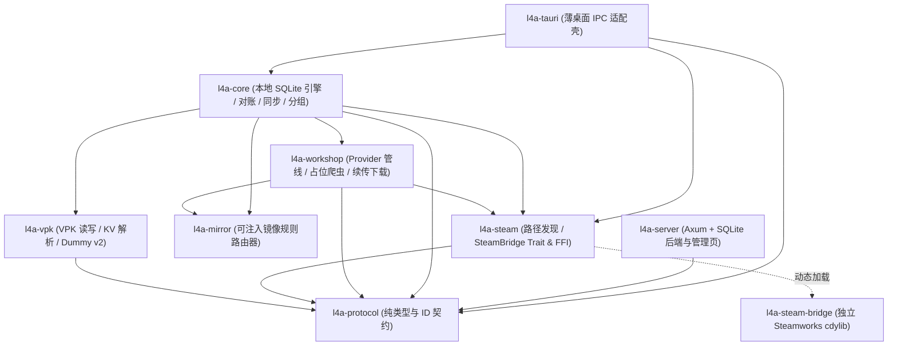

# 01. 总体架构与 Crate 分层

## 1. 为何重构 v2

`v1` 在早期迭代中累积了大量职责耦合问题：`src-tauri/src/commands/handlers/mod.rs` 膨胀到超过 4600 行，同时混杂了文件操作、VPK 解析、Steamworks FFI 调用、网页 HTML 爬取策略、HTTP 断点下载、自动分组启发式和 JSON 数据库读写；前端也承担了本应属于本地引擎的任务队列与数据融合逻辑。

`v2` 采用**六边形架构（Hexagonal Architecture / Ports & Adapters）**与 **Cargo 多 Crate Workspace**，强迫领域规则与外部依赖解耦：

| v1 痛点 | v2 架构解法 |
| --- | --- |
| 所有逻辑堆在 `src-tauri` 内，难测试、难复用 | 拆分为 8 个职责单一 Crate；`src-tauri` 退化为 <350 行的薄桌面 IPC 壳 |
| Steam SDK / Web API / 网页抓取源混乱交织 | `l4a-workshop` 定义 `WorkshopProvider` Trait 与多源优先级合并器；网页抓取留显式占位符 |
| 无远程数据缓存服务端，重复请求受限流折磨 | 新增 `l4a-server`（Axum + SQLite + `/admin` 管理页），支持可信玩家提交与冲突裁决 |
| 未建模远程下架、版本变更与依赖包退场 | `l4a-core::lifecycle` 维护状态快照与依赖边历史，支持多父模组引用安全检测 |
| Dummy Bypass 被游戏更新覆写或自动下新包时盲人摸象 | `l4a-vpk` 引入 Dummy v2 元信息；`l4a-core::reconcile` 在扫描时主动检出 6 类漂移并提供修复动作 |
| 分组模型混合自动聚类、合集同步与用户标签，双向引用易丢失 | 拆为正交 4 层：`Bundle` / `TrackedCollection` / `UserGroup` / `LoadoutProfile` |
| 单测仅作为事后补丁，依赖真实 Steam/网络/文件系统 | 所有外设边界均有 Trait 抽象与本地内存/Mock Server 测试，零外网依赖秒级跑通全量测试 |

## 2. Crate 依赖有向无环图 (DAG)

> 关键工程约束：根目录 `default-members` 仅包含前 7 个纯跨平台 Crate，因此无 GTK/WebKit 的服务器或 CI 环境也可以直接运行 `cargo test` 和 `l4a-server`。
