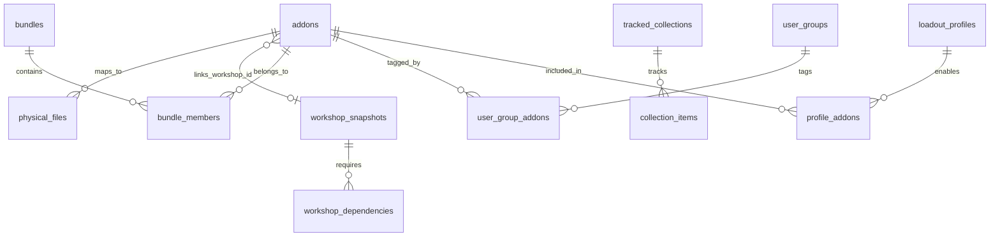

# 02. 领域模型与本地存储设计

## 1. 核心理念：逻辑 Addon 与物理文件分离

v1 最大的数据结构缺陷是把「逻辑上的模组记录」和「磁盘上的某个 `.vpk` 文件」绑死在一起，并在扫描时直接跳过 Dummy 文件。这导致：
1. 重命名去掉文件名中的 Workshop ID 后容易丢失身份归属；
2. 同一模组同时在 `addons/` 和 `addons/workshop/` 存在真实文件（例如游戏更新覆写 Dummy）时，无法表达冲突状态。

v2 严格区分为两张表：
- **`addons`（逻辑实体）**：主键为 `ws:<workshop_id>` 或 `hash:<content_sha256>`。承载标题、作者、地图列表、安装状态 (`installed | uninstalled_known | missing_file`)、`local_time_updated` 等逻辑属性。
- **`physical_files`（磁盘观测真相）**：主键为完整磁盘路径。记录所有 `.vpk` / `.vpk.disabled` 文件（包含 `RealAddon`、`DummyV1`、`DummyV2`、`Corrupted`），供扫描器增量跳过未修改文件，并作为 Dummy v2 对账引擎的唯一输入。

## 2. 本地 SQLite 数据库 ER 图

## 3. 配置文件分离原则

- **`config/settings.toml`**：用户配置（目录路径、并发数、Dummy 策略、Catalog Server 地址、重命名规则），人类可读可手工编辑。
- **`config/mirrors.json`**：沿用 v1 兼容的高级镜像/反代规则（见 [mirrors-configuration.md](../guides/mirrors-configuration.md)）。
- **`l4a_v2.db` (SQLite WAL)**：全部高频写入与关联查询数据，事务保证不会在崩溃时破坏数据库完整性。
