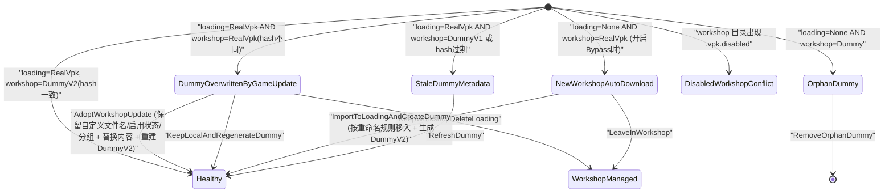

# 04. Dummy Bypass v2 与目录对账引擎

## 1. v1 的两个未解决场景

1. **游戏更新覆写 Dummy**：当作者发布新版时，Steam/L4D2 会直接把新 `.vpk` 下载写入 `addons/workshop/<id>.vpk`，把原来用于绕过检查的 Dummy 覆盖掉。`loading/` 下仍留着用户重命名（且可能已被禁用或加入分组）的旧版真实 VPK。v1 仅以 `vpk_name` 为主扫描且没有追踪两边的真实文件关系。
2. **游戏自动下载新组件**：在联机、新订阅或合集变更后，L4D2 自动往 `addons/workshop/` 写入全新 `.vpk`。若用户开启了 Dummy Bypass 模式，旧版工具无法感知并提示迁移。

## 2. Dummy v2 自描述格式 (`crates/l4a-vpk/src/dummy.rs`)

Dummy v2 VPK 在 `addoninfo.txt` 内写入机器可验证的指纹元数据，同时保留 `addontitle`、`addonversion` 与封面图：

```text
"AddonInfo"
{
    "addonSteamAppID" "550"
    "addonversion" "1.0"
    "addontitle" "Campaign Name (L4A Dummy)"
    "addonDescription" "A dummy addon generated by Left 4 Addons"
    "l4aDummy" "2"
    "l4aWorkshopId" "888001"
    "l4aOriginalHash" "<loading 真实 VPK 的 SHA-256 指纹>"
    "l4aOriginalSize" "12345678"
    "l4aOriginalTimeUpdated" "1700000000"
    "l4aGeneratedAt" "2026-11-19T12:00:00Z"
}
```

## 3. 对账状态机 (`crates/l4a-core/src/reconcile.rs`)



## 4. `AdoptWorkshopUpdate` 与忽略持久化保证

执行 `AdoptWorkshopUpdate` 时，引擎按以下步骤原子操作：
1. 先校验并读取 `workshop/<id>.vpk` 的新内容指纹和远程 `time_updated`（损坏 VPK 会被拒绝，不会破坏现有 `loading/` 文件）；
2. 将 `workshop/<id>.vpk` 通过带回滚备份的原子替换移动到用户在 `loading/` 下原有的 `current_path`（**完整保留用户的自定义文件名与 `.disabled` 禁用状态**）；
3. 逻辑 `AddonId` 与所有 `UserGroup` / `Bundle` / `LoadoutProfile` 关联纹丝不动；
4. 在 `workshop/<id>.vpk` 通过临时文件原子写入携带新 `l4aOriginalHash` 的 Dummy v2。

当用户对某条对账告警执行 `Ignore` 或 `LeaveInWorkshop` 时，`reconcile_issues` 会记住该问题当前关联物理文件的状态指纹 (`state_fingerprint`)：
- 只要对应磁盘文件未发生变化，后续多次 `scan()` 均持续保持已解决/忽略状态，不再重复弹窗；
- 一旦磁盘上对应 `.vpk` 的大小、修改时间或内容指纹发生变化，对账引擎会自动重新检出新状态并触发告警。
