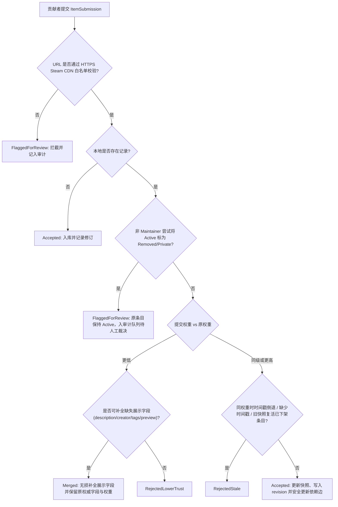

# 07. `l4a-server` 创意工坊信息管理/缓存后端设计

## 1. 定位与技术选型

- **技术栈**：Rust (`Axum 0.8` + `rusqlite` SQLite WAL) + 自包含单文件暗色 Web 管理页面（`GET /admin`）。
- **核心价值**：
  1. 减少单机客户端直连 Steam 网页触发 `429 Too Many Requests` 的概率；
  2. 记录模组在被下架或作者撤回分包前的历史修订与依赖边，避免“死链变黑盒”；
  3. 允许服主/社区通过 **可信玩家 Token** 上报客户端经 SDK/WebAPI 核验到的元数据，与未来接入的服务端爬虫互补。

- **信任分级与安全边界** (`crates/l4a-server/src/ingest.rs`)：
  - 所有管理操作需要强管理员令牌（`--admin-token` / `L4A_SERVER_ADMIN_TOKEN`，禁止默认弱口令上线；本地回环调试需显式 `--allow-insecure-dev-token`），管理路由不挂载宽松 CORS，`/admin` 页启用 CSP 与事件委托，令牌仅暂存于 `sessionStorage`；
  - `file_url` / `preview_url` 校验为 `https://` 且命中 Steam CDN 域名白名单；
  - `AdminOverride` 使用最高权威权重 (`200`)，`Official` (`100`) 亦不可覆盖；
  - `SteamWebApi` 等无依赖来源更新时默认不擦除现有依赖边；
  - 非 `Maintainer` 尝试将 `Active` 标为下架/私密时强制进入 `FlaggedForReview`，且低权重仅可补全无害展示字段（`description` / `creator_name` / `tags` / `preview_url`），绝不以低信任 `file_url` 或伪造依赖污染高信任主记录。

## 2. 冲突裁决与防投毒状态机

## 3. 内置管理页 (`GET /admin`)

无需任何 Node.js/前端打包流程，`l4a-server` 启动后直接通过浏览器访问 `http://<bind>/admin`，输入 `X-Admin-Token` 即可：
- 查看缓存统计、下架数与待审阅冲突总数；
- 按关键词或 ID 检索条目并执行强制状态/标题/依赖覆写；
- 生成可信玩家 Token（明文只展示一次，数据库只存 SHA-256 哈希）或一键禁用滥用 Token；
- 审查最近 200 条提交审计日志（高亮 `flagged_for_review`）；
- 查看服务端爬虫占位模块 (`PlaceholderCatalogScraper`) 队列与接入状态。

## 4. 详细部署与 API 规范

关于生产环境安装（Systemd、Docker、Nginx/Caddy 反向代理）、环境变量配置、Token 签发与客户端连接配置的完整步骤，请参见：
- [Catalog Server 介绍与部署指南 (`docs/guides/catalog-server-guide.md`)](../guides/catalog-server-guide.md)
- [Catalog Server REST API 规范 (`docs/api/catalog-server-api.md`)](../api/catalog-server-api.md)
- [ADR-003: 创意工坊多源管道与自托管缓存后端](../adr/ADR-003-workshop-provider-pipeline-and-catalog-backend.md)
