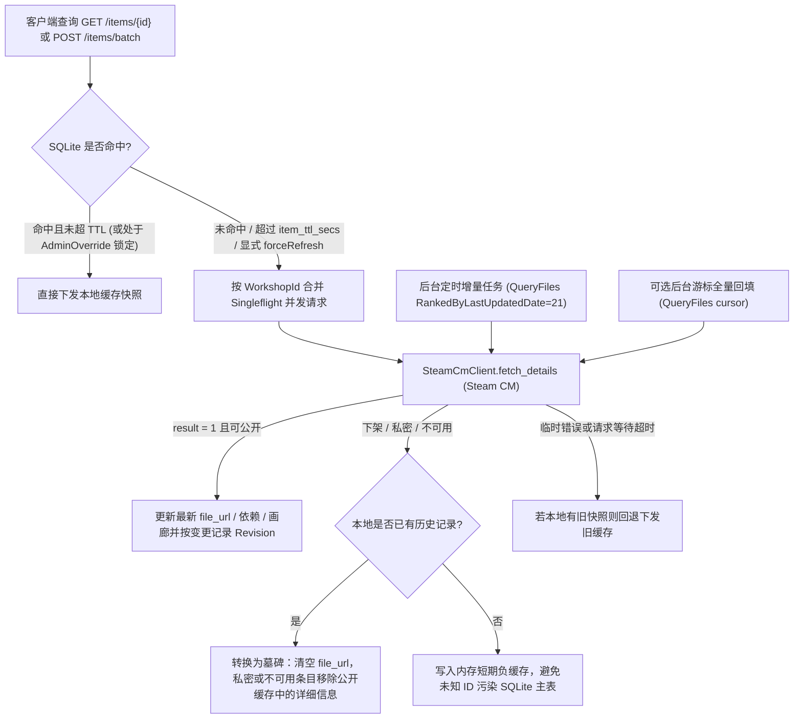

# 07. `l4a-server` SteamKit CM 创意工坊缓存后端设计

## 1. 定位与重构背景

由于《求生之路 2》(AppID `550`) 客户端在挂载 `steam_api` (Steamworks SDK) 的状态下启动或并行运行存在潜在的 VAC 冲突与进程占用限制，Left4Addons v2 将 `l4a-server` 定位为**在服务端替代 Steamworks SDK 的权威缓存下发节点**：

- **技术栈**：Rust (`Axum 0.8` + `rusqlite` SQLite WAL 读写分离连接池 + `steam-vent` 纯协议层 SteamKit CM 客户端) + React 19 管理控制台 (`src-catalog/` -> 内嵌至二进制 `GET /admin/`)。
- **无上报纯上游架构**：`SteamCmClient` 通过 Steam CM 协议的 `PublishedFile.GetDetails` 与 `PublishedFile.QueryFiles` 原生获取模组元数据、前置依赖 (`children`)、合集成员、画廊 (`previews`) 以及 `.vpk` CDN 下载直链 (`file_url`)，因此彻底移除了早期众包贡献者上报 (`POST /api/v1/submissions`) 与 Steam Web API 依赖。
- **TOML 持久化配置 (`catalog.toml`)**：抛弃繁琐的环境变量配置，首次启动自动生成带高强度随机密码的 `catalog.toml`（Unix 权限 `0600`），运行时修改同步策略、管理员密码或登录 Steam 账号后自动通过临时文件原子落盘。

## 2. 缓存保鲜、Singleflight 与下架墓碑流转

针对模组作者更新组件后旧版 `file_url` 可能失效的问题，`CatalogSyncCoordinator` (`crates/l4a-server/src/sync.rs`) 采用三层协同策略：

缓存按 Steam 版本与请求观测时间合并快照。客户端按 ID Read-Through 穿透拉取的条目仅作为缓存保存，不会直接进入公开工坊首页与公开搜索，避免个人已安装组件列表暴露或覆盖首页内容；公开搜索仅展示经增量同步、全量回填、管理员主动抓取或人工覆写收录的公开条目，不再因 `item_ttl_secs` 到期而大面积隐藏已收录目录。后台会独立于增量同步和回填，按 ID 分批复核接近过期及可见性未知的目录条目。未列出条目仅允许按 ID 查询。增量与回填按消费 App ID 选择工坊。 [Steamworks 可见性定义](https://partner.steamgames.com/doc/api/ISteamRemoteStorage#ERemoteStoragePublishedFileVisibility) [QueryFiles 参数](https://partner.steamgames.com/doc/webapi/IPublishedFileService#QueryFiles)

从缺少目录收录字段的旧库升级时，已确认公开的管理员覆写继续展示，来源不明的条目保留为按 ID 查询的缓存。迁移重置增量水位线、回填游标和回填计数，已启用的同步任务会重新建立目录收录状态。

## 3. SteamKit CM 双模式会话 (`crates/l4a-server/src/upstream.rs`)

1. **匿名 CM 模式 (`anonymous`，默认开箱即用)**：
   - 直接通过 `Connection::anonymous` 连接 Steam CM 服务器；
   - 支持获取全部公开创意工坊条目的 `file_url`、依赖树、合集与画廊预览。
2. **账号登录模式 (`account`)**：
   - 管理员可在 Web 控制台中通过 **手机 Steam 扫码 (`BeginAuthSessionViaQR`)**、**账号密码 + Steam Guard 验证码/手机确认** 或 **导入 Refresh Token** 登录普通 Steam 账号；
   - 成功后仅将持久化 `refresh_token` 写入 `catalog.toml`（绝不落盘明文密码），并支持通过 `Player.GetPlayerLinkDetails` 批量补全创作者昵称 (`creator_name`)。

## 4. 混合搜索引擎 (`crates/l4a-server/src/hybrid_search.rs`)

### 4.1 为什么 Steamworks SDK 与旧版请求会搜偏
早期的客户端 `l4a-steam-bridge`（`ISteamUGC`）在构造 `QueryFiles` 时同时传入了 `creator_appid = 550` 与 `consumer_appid = 550`。然而《求生之路 2》绝大多数战役与地图是通过 **Left 4 Dead 2 Authoring Tools (`creator_appid = 563`)** 发布的（仅 `consumer_appid = 550`），导致 SDK 将所有官方工具上传的战役全部漏掉并退化为宽松匹配。

在服务端 `SteamCmClient::search_files` 中，通过 `CPublishedFile_QueryFiles_Request` 显式保持 `creator_appid = None`、`appid = Some(550)`，并透传：
- `language`（字段 33，`ELanguage` 整数，由 `?lang=` / `Accept-Language` / `search.default_language` 推导）；
- `search_text_target`（协议字段 50，`0=All` / `1=Title` / `2=Description`）；
- `filetype`（`0=Items` / `1=Collections`）、`requiredtags`、`days` 与 `query_type`（`12=TextSearch`、`3=Trend`、`0=Vote`、`9=TotalUniqueSubscriptions`、`21=LastUpdatedDate`、`1=PublicationDate`）。

经实测，上述协议调用返回与 `steamcommunity.com/workshop/browse/` 逐条一致的相关性排序、多语言本地化标题与 `total` 总数，同时一步带回 `file_url`、依赖树与画廊预览，无需 HTML 抓取。

### 4.2 混合融合、单飞短缓存与暖缓存策略
- **本地强命中提升 & 本地兜底**：Steam CM 负责全量语义检索与官方排序；本地 SQLite FTS5 补充中文拼音（如 `guangzhou` → `广州增城`）、去空格/驼峰复合词（如 `EarlyDays` / `DayBreak`）、作者名检索、`AdminOverride` 覆写与离线/超时降级（`X-L4A-Search-Mode: local-fallback`）。
- **单飞并发合并与 60 秒内存缓存**：相同的 `SteamSearchRequest` 共享同一个在途 CM 请求并在内存中缓存 `cache_ttl_secs`（默认 60 秒，上限 512 项），避免连续翻页或重复搜索放大上游延迟。
- **覆写、隐私隔离与异步 `CacheOnly` 暖缓存**：合并阶段严格过滤 `listed == false`、`consumer_appid != app_id` 及本地已知私密/受限条目，并叠加 `AdminOverride` 与本地 `creator_name`。搜索命中的公开条目以 `CatalogIndexPolicy::CacheOnly` 异步写入本地缓存（非英文检索仅缓存本地尚未收录的新 ID，不覆盖英文规范标题），既加速后续按 ID 获取直链，又不污染公开首页目录。

## 5. 管理控制台 (`GET /admin/`) 与安全边界

- **会话鉴权 (`crates/l4a-server/src/auth.rs`)**：支持登录签发 `HttpOnly; SameSite=Strict` 会话 Cookie，同时兼容 CLI/脚本调用的 `Authorization: Bearer <token>` 与 `X-Admin-Token` 常量时间比对。
- **管理路由隔离**：公开查询路由挂载查询所需的 CORS。依赖 Cookie 的管理写请求校验会话 CSRF Token，CLI 仍可使用显式凭证。管理操作记录在 `audit_log` 中。

## 6. 相关文档

- [Catalog Server 介绍与部署指南 (`docs/guides/catalog-server-guide.md`)](../guides/catalog-server-guide.md)
- [Catalog Server REST API 规范 (`docs/api/catalog-server-api.md`)](../api/catalog-server-api.md)
