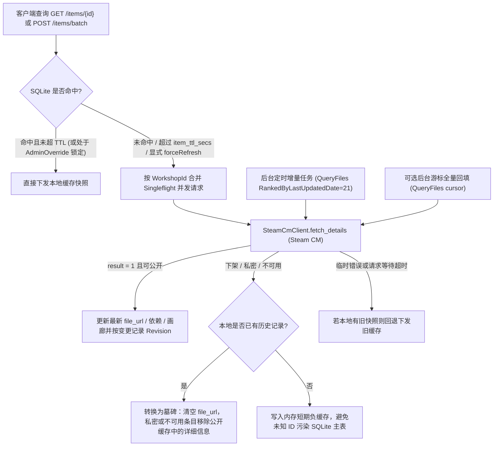

# 07. `l4a-server` SteamKit CM 创意工坊缓存后端设计

## 1. 定位与重构背景

由于《求生之路 2》(AppID `550`) 客户端在挂载 `steam_api` (Steamworks SDK) 的状态下启动或并行运行存在潜在的 VAC 冲突与进程占用限制，Left4Addons v2 将 `l4a-server` 定位为**在服务端替代 Steamworks SDK 的权威缓存下发节点**：

- **技术栈**：Rust (`Axum 0.8` + `rusqlite` SQLite WAL 读写分离连接池 + `steam-vent` 纯协议层 SteamKit CM 客户端) + React 19 管理控制台 (`src-catalog/` -> 内嵌至二进制 `GET /admin/`)。
- **无上报纯上游架构**：`SteamCmClient` 通过 Steam CM 协议的 `PublishedFile.GetDetails` 与 `PublishedFile.QueryFiles` 原生获取模组元数据、前置依赖 (`children`)、合集成员、画廊 (`previews`) 以及 `.vpk` CDN 下载直链 (`file_url`)，因此彻底移除了早期众包贡献者上报 (`POST /api/v1/submissions`) 与 Steam Web API 依赖。
- **TOML 持久化配置 (`catalog.toml`)**：抛弃繁琐的环境变量配置，首次启动自动生成带高强度随机密码的 `catalog.toml`（Unix 权限 `0600`），运行时修改同步策略、管理员密码或登录 Steam 账号后自动通过临时文件原子落盘。

## 2. 缓存保鲜、Singleflight 与下架墓碑流转

针对模组作者更新组件后旧版 `file_url` 可能失效的问题，`CatalogSyncCoordinator` (`crates/l4a-server/src/sync.rs`) 采用三层协同策略：

缓存按 Steam 版本与请求观测时间合并快照。启用增量同步时，后台也会按 ID 分批复核接近过期及可见性未知的条目。公开搜索排除过期活跃条目，并保留未列出条目的按 ID 查询。增量与回填按消费 App ID 选择工坊。 [Steamworks 可见性定义](https://partner.steamgames.com/doc/api/ISteamRemoteStorage#ERemoteStoragePublishedFileVisibility) [QueryFiles 参数](https://partner.steamgames.com/doc/webapi/IPublishedFileService#QueryFiles)

## 3. SteamKit CM 双模式会话 (`crates/l4a-server/src/upstream.rs`)

1. **匿名 CM 模式 (`anonymous`，默认开箱即用)**：
   - 直接通过 `Connection::anonymous` 连接 Steam CM 服务器；
   - 支持获取全部公开创意工坊条目的 `file_url`、依赖树、合集与画廊预览。
2. **账号登录模式 (`account`)**：
   - 管理员可在 Web 控制台中通过 **手机 Steam 扫码 (`BeginAuthSessionViaQR`)**、**账号密码 + Steam Guard 验证码/手机确认** 或 **导入 Refresh Token** 登录普通 Steam 账号；
   - 成功后仅将持久化 `refresh_token` 写入 `catalog.toml`（绝不落盘明文密码），并支持通过 `Player.GetPlayerLinkDetails` 批量补全创作者昵称 (`creator_name`)。

## 4. 管理控制台 (`GET /admin/`) 与安全边界

- **会话鉴权 (`crates/l4a-server/src/auth.rs`)**：支持登录签发 `HttpOnly; SameSite=Strict` 会话 Cookie，同时兼容 CLI/脚本调用的 `Authorization: Bearer <token>` 与 `X-Admin-Token` 常量时间比对。
- **管理路由隔离**：公开查询路由挂载查询所需的 CORS。依赖 Cookie 的管理写请求校验会话 CSRF Token，CLI 仍可使用显式凭证。管理操作记录在 `audit_log` 中。

## 5. 相关文档

- [Catalog Server 介绍与部署指南 (`docs/guides/catalog-server-guide.md`)](../guides/catalog-server-guide.md)
- [Catalog Server REST API 规范 (`docs/api/catalog-server-api.md`)](../api/catalog-server-api.md)
