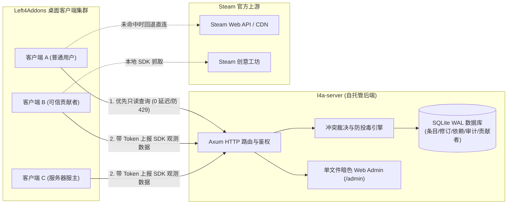

# Catalog Server (l4a-server) 介绍与部署指南

`l4a-server` 是 Left4Addons v2 体系中独立、轻量且可自托管的**创意工坊信息管理与元数据缓存服务**。它基于 Rust 开发（Axum 0.8 + rusqlite SQLite WAL），专为解决《求生之路 2》创意工坊模组元数据分散、Steam 网页频繁 429 限流、模组下架后依赖关系丢失，以及社区服主/玩家之间难以高效共享模组信息的痛点而设计。

---

## 一、什么是 Catalog Server？

### 1.1 背景与痛点

在 Left4Addons 的日常使用与大规模模组管理中，直接依赖 Steam 官方接口存在以下主要问题：

1. **Steam 网页与 API 频繁 429 限流**：
   单机客户端在批量检测订阅更新、查询依赖关系或检索大量条目时，极易触发 Steam 社区的 `429 Too Many Requests` 限流，导致封面与模组信息加载失败。
2. **模组下架与私密导致“死链变黑盒”**：
   当创意工坊作者删除模组、将其设为隐藏或私密时，Steam 官方 API 会直接返回条目不存在或错误，客户端无法得知该条目的历史标题、封面、描述以及它曾作为哪些地图的前置依赖。
3. **多端数据孤岛与信息不同步**：
   不同玩家、服务器管理员在本地通过 Steamworks SDK 观测到的真实元数据（包括直链、文件大小、更新时间戳等）无法汇总共享。
4. **开放上报下的恶意数据投毒风险**：
   如果允许客户端自由提交数据，容易遭受恶意篡改（例如伪造钓鱼直链、恶意将正常模组标为下架、破坏依赖拓扑等）。

### 1.2 核心定位与解决方案

`l4a-server` 作为社区或自建的中心节点，充当 Left4Addons 客户端的**第一优先级智能缓存与协同信息库**：



### 1.3 核心特性

- **高性能与极低资源开销**：单二进制文件运行，内存占用通常低于 30MB，基于 SQLite WAL 模式，读写并发能力优秀。
- **历史版本与依赖关系归档**：模组每次合规更新都会被记录在 `workshop_item_revisions` 中；即使条目被 Steam 下架，历史标题、描述与依赖 DAG 依然完整保留。
- **分级可信贡献机制**：支持生成可信贡献者令牌（Contributor Token），为不同上报来源（服主、巡查员、自动化机器人、普通玩家）分配信任权重。
- **严格的安全与防篡改规则**：
  - **Steam CDN 域名白名单**：强制所有 `file_url` 和 `preview_url` 必须为 `https://` 且属于官方域名（如 `*.steamcontent.com`, `*.steamstatic.com`, `*.steampowered.com`），杜绝任意恶意外部链接。
  - **防恶意下架保护**：低权重贡献者尝试将已存在的正常条目标为下架或私密时，系统强制拦截并进入待审阅队列（`FlaggedForReview`），决不自动覆盖有效条目。
  - **字段无损补全（Merged）**：低权重上报仅允许补全缺失的无害展示字段（如描述、作者名、标签），高权重字段（如直链、权威时间戳）受严格保护。
- **内置单文件暗色管理后台 (`GET /admin`)**：
  无需搭建任何 Node.js、Vue 或 React 前端构建环境，后端内置单文件响应式暗色管理页面，支持模组检索、条目强制覆写、贡献者 Token 签发与禁用、提交审计日志查看。

---

## 二、配置与参数详解

`l4a-server` 同时支持通过**命令行参数**或**环境变量**进行配置。

### 2.1 参数配置表

| 命令行参数 | 环境变量 | 默认值 | 说明 |
| :--- | :--- | :--- | :--- |
| `--bind <ADDR>` | `L4A_SERVER_BIND` | `127.0.0.1:8787` | HTTP 监听地址与端口。生产环境建议绑定在 `127.0.0.1` 并配合 Nginx/Caddy 等反向代理，或绑定在 `0.0.0.0:8787`。 |
| `--db-path <PATH>` | `L4A_SERVER_DB` | `./l4a-catalog.db` | SQLite 数据库文件存储路径。若父目录不存在，服务会自动递归创建。 |
| `--admin-token <TOKEN>` | `L4A_SERVER_ADMIN_TOKEN` | *(无)* | 管理员令牌（强口令）。用于登录 Web 管理后台和访问 `/api/v1/admin/*` 接口。**生产环境必须显式指定**。 |
| `--allow-insecure-dev-token` | *(无)* | `false` | 仅供本地开发调试使用的开关。允许使用弱口令（如 `change-me-admin-token`）。**限制：必须绑定在回环地址（127.0.0.1 / localhost / [::1]），否则拒绝启动**。 |

### 2.2 安全启动约束

为了保障数据安全，`l4a-server` 内置了防御性启动检查：
1. **禁止默认弱口令**：若未传入 `--admin-token` / `L4A_SERVER_ADMIN_TOKEN`，或口令等于默认测试串 `change-me-admin-token`，服务将直接退出并报错。
2. **生产禁止回环放行**：只有在显式指定 `--allow-insecure-dev-token` 且 `--bind` 确为本地回环地址时，才允许使用弱口令启动。任何对外暴露的 IP（如 `0.0.0.0`）均强制要求设置高强度强令牌。

---

## 三、部署方案实战

你可以根据实际运维环境选择以下部署方式之一：

### 方案 A：原生编译与 Systemd 服务部署 (推荐 Linux 生产环境)

#### 步骤 1：编译可执行文件

在具有 Rust 环境的机器上构建 Release 二进制：

```bash
# 进入项目仓库根目录
cargo build --release -p l4a-server

# 编译产物位于 target/release/l4a-server
# 将二进制文件拷贝至系统的可执行目录
sudo cp target/release/l4a-server /usr/local/bin/l4a-server
sudo chmod +x /usr/local/bin/l4a-server
```

#### 步骤 2：创建独立运行用户与数据目录

为了保障安全性，避免使用 `root` 用户直接运行服务：

```bash
# 创建非登录系统用户 l4a
sudo useradd --system --no-create-home --shell /usr/sbin/nologin l4a

# 创建持久化数据库存储目录并赋权
sudo mkdir -p /var/lib/l4a-server
sudo chown -R l4a:l4a /var/lib/l4a-server
sudo chmod 750 /var/lib/l4a-server
```

#### 步骤 3：配置环境变量文件

生成一个安全的随机管理员 Token 并写入配置文件：

```bash
# 生成 32 字节高强度随机 Token
ADMIN_TOKEN=$(openssl rand -hex 32)
echo "生成的管理员令牌为: $ADMIN_TOKEN (请妥善保存)"

# 写入安全环境配置文件
sudo bash -c "cat <<EOF > /etc/l4a-server.env
L4A_SERVER_BIND=127.0.0.1:8787
L4A_SERVER_DB=/var/lib/l4a-server/catalog.db
L4A_SERVER_ADMIN_TOKEN=${ADMIN_TOKEN}
RUST_LOG=info
EOF"

sudo chmod 600 /etc/l4a-server.env
sudo chown l4a:l4a /etc/l4a-server.env
```

#### 步骤 4：编写 Systemd Service 单元

创建 `/etc/systemd/system/l4a-server.service`：

```ini
[Unit]
Description=Left4Addons Catalog Server
After=network.target

[Service]
Type=simple
User=l4a
Group=l4a
EnvironmentFile=/etc/l4a-server.env
ExecStart=/usr/local/bin/l4a-server
Restart=always
RestartSec=5s

# 安全加固项
ProtectSystem=strict
ProtectHome=true
ReadWritePaths=/var/lib/l4a-server
PrivateTmp=true
NoNewPrivileges=true

[Install]
WantedBy=multi-user.target
```

#### 步骤 5：启动与开机自启

```bash
# 重载 systemd 并启动服务
sudo systemctl daemon-reload
sudo systemctl enable --now l4a-server

# 查看运行状态与日志
sudo systemctl status l4a-server
sudo journalctl -u l4a-server -f
```

---

### 方案 B：Docker / Docker Compose 容器化部署

如果你习惯使用容器化部署，可以通过以下 Dockerfile 和 Compose 编排文件快速启动。

#### 1. `Dockerfile` (多阶段精简构建)

在项目根目录下或构建机上编写 `Dockerfile`：

```dockerfile
# --- 构建阶段 ---
FROM rust:1.80-bullseye AS builder
WORKDIR /app
COPY . .
RUN cargo build --release -p l4a-server

# --- 运行阶段 ---
FROM debian:bullseye-slim
RUN apt-get update && apt-get install -y --no-install-recommends \
    ca-certificates \
    && rm -rf /var/lib/apt/lists/*

# 创建非特权运行用户
RUN useradd --system --no-create-home --shell /usr/sbin/nologin l4a
WORKDIR /data
RUN chown -R l4a:l4a /data

COPY --from=builder /app/target/release/l4a-server /usr/local/bin/l4a-server

USER l4a
EXPOSE 8787

ENV L4A_SERVER_BIND=0.0.0.0:8787 \
    L4A_SERVER_DB=/data/catalog.db \
    RUST_LOG=info

VOLUME ["/data"]
ENTRYPOINT ["/usr/local/bin/l4a-server"]
```

#### 2. `docker-compose.yml`

```yaml
version: '3.8'

services:
  l4a-server:
    image: l4a-server:latest
    build:
      context: .
      dockerfile: Dockerfile
    container_name: l4a-catalog-server
    restart: unless-stopped
    ports:
      - "127.0.0.1:8787:8787"
    environment:
      - L4A_SERVER_BIND=0.0.0.0:8787
      - L4A_SERVER_DB=/data/catalog.db
      - L4A_SERVER_ADMIN_TOKEN=your-ultra-secure-random-token-here # 请替换为实际安全令牌
      - RUST_LOG=info
    volumes:
      - ./catalog-data:/data
```

启动命令：
```bash
docker compose up -d
docker compose logs -f
```

---

### 方案 C：反向代理与 HTTPS 配置 (Nginx / Caddy)

在公网生产环境中，**强烈建议**在 `l4a-server` 前挂载 Nginx 或 Caddy 等反向代理，用于终止 TLS (HTTPS)、启用 HTTP/2、限制连接速率，以及限制 `/admin` 控制台的外网访问。

#### 1. Nginx 配置示例

```nginx
# 限制客户端并发连接与请求速率
limit_req_zone $binary_remote_addr zone=catalog_api:10m rate=30r/s;

server {
    listen 80;
    server_name catalog.example.com;
    return 301 https://$host$request_uri;
}

server {
    listen 443 ssl http2;
    server_name catalog.example.com;

    ssl_certificate /etc/letsencrypt/live/catalog.example.com/fullchain.pem;
    ssl_certificate_key /etc/letsencrypt/live/catalog.example.com/privkey.pem;

    # 1. 公开 API 路由 (允许跨域与并发)
    location /api/v1/ {
        limit_req zone=catalog_api burst=50 nodelay;
        proxy_pass http://127.0.0.1:8787;
        proxy_set_header Host $host;
        proxy_set_header X-Real-IP $remote_addr;
        proxy_set_header X-Forwarded-For $proxy_add_x_forwarded_for;
        proxy_set_header X-Forwarded-Proto $scheme;
    }

    # 2. Web 管理后台与管理员 API (建议限制 IP 或加强防护)
    location /admin {
        # 可选：仅允许特定运维 IP 访问
        # allow 192.168.1.0/24;
        # allow 10.0.0.0/8;
        # deny all;

        proxy_pass http://127.0.0.1:8787;
        proxy_set_header Host $host;
        proxy_set_header X-Real-IP $remote_addr;
        proxy_set_header X-Forwarded-For $proxy_add_x_forwarded_for;
        proxy_set_header X-Forwarded-Proto $scheme;
    }

    location /api/v1/admin/ {
        # 可选：仅允许特定运维 IP 访问
        # allow 192.168.1.0/24;
        # deny all;

        proxy_pass http://127.0.0.1:8787;
        proxy_set_header Host $host;
        proxy_set_header X-Real-IP $remote_addr;
        proxy_set_header X-Forwarded-For $proxy_add_x_forwarded_for;
        proxy_set_header X-Forwarded-Proto $scheme;
    }
}
```

#### 2. Caddy 配置示例

Caddy 提供极其简便的自动证书申请与反向代理能力：

```caddy
catalog.example.com {
    encode gzip zstd

    # 仅允许局域网或指定 IP 访问管理面板（可选）
    @blocked_admin {
        path /admin* /api/v1/admin/*
        not remote_ip 192.168.0.0/16 127.0.0.1
    }
    respond @blocked_admin "Access Denied" 403

    reverse_proxy 127.0.0.1:8787
}
```

---

## 四、管理控制台与日常运维

### 4.1 访问管理面板 (`GET /admin`)

部署完成后，在浏览器中打开：
```
http://<你的服务器地址>:8787/admin
# 或在配置反代后访问：
https://catalog.example.com/admin
```

首次进入会提示输入管理员令牌（即部署时设置的 `L4A_SERVER_ADMIN_TOKEN`）：
- **安全性说明**：管理后台采用严格的 Content Security Policy (CSP)，无第三方外部脚本引用；管理员令牌仅保存在当前浏览器的 `sessionStorage` 中，关闭标签页即自动失效。

### 4.2 签发与管理 Contributor Token

在管理后台的 **“贡献者授权 (Contributors)”** 标签页中：
1. 点击 **“新建贡献者”**：
   - **名称**：输入识别标识（如 `server-node-tokyo`、`moderator-alice`、`community-crawler-bot`）。
   - **信任等级 (Trust Tier)**：
     - `Untrusted` (权重 10)：未经验证的普通上报源，仅能补全无害展示文本。
     - `AutomatedBot` (权重 80)：常规轮询机器人。
     - `Contributor` (权重 100)：社区服主、活跃模组巡查员。
     - `Maintainer` (权重 150)：受信任的维护者，允许标记模组为下架或私密。
2. **复制 Token**：系统生成格式为 `l4a_<uuid><uuid>` 的一次性明文 Token。**明文只展示一次**，数据库仅存储其 SHA-256 哈希值。
3. **禁用与撤销**：若某贡献者 Token 泄露或行为异常，可在列表点击 **“禁用”**，其所有后续上报将立即被拒绝 (`403 Forbidden`)。

### 4.3 冲突审阅与数据人工覆写

1. **审计日志 (Audit Logs)**：在管理控制台可查看最近 200 条数据上报与冲突仲裁日志。所有被系统拦截的非白名单 URL、低信任伪造下架等均被高亮标记为 `flagged_for_review`。
2. **条目覆写 (Item Override)**：管理员可通过后台强制覆写任何模组的：
   - 运行状态：`active` (活跃) / `removed` (官方下架) / `private_or_unavailable` (私密或失效)；
   - 标题与描述；
   - 真实直链 (`file_url`)；
   - 显式依赖关系树。
   管理员覆写权重为最高优先级（`200`），任何自动上报均无法覆盖管理员设定的结果。

### 4.4 数据库备份与维护

`l4a-server` 使用单文件 SQLite，并开启了 WAL 模式。

- **热备份（在线安全备份）**：
  无需停机，使用 `sqlite3` 内置的在线备份命令即可安全生成备份文件：
  ```bash
  sqlite3 /var/lib/l4a-server/catalog.db ".backup '/backup/catalog-$(date +%Y%m%d%H%M%S).db'"
  ```
- **自动日常备份 Cron 脚本示例**：
  ```bash
  # /etc/cron.daily/l4a-backup
  #!/bin/bash
  BACKUP_DIR="/var/backups/l4a-catalog"
  mkdir -p "$BACKUP_DIR"
  sqlite3 /var/lib/l4a-server/catalog.db ".backup '$BACKUP_DIR/catalog-$(date +\%F).db'"
  find "$BACKUP_DIR" -name "catalog-*.db" -mtime +14 -delete
  ```
- **注意文件组成**：在服务运行时，目录下可能会同时出现 `catalog.db`、`catalog.db-wal`、`catalog.db-shm` 三个文件。直接使用普通 `cp` 拷贝可能会导致事务不一致，请务必使用 `sqlite3 .backup` 或在停机状态下复制。

---

## 五、在 Left4Addons 客户端中配置使用

服务端部署完成后，即可在各客户端进行连接配置。

### 5.1 界面配置步骤

1. 打开 Left4Addons 桌面客户端，点击右上角进入 **设置 (Settings)** 页面；
2. 切换至 **“数据源与创意工坊 (Data Sources)”** 分区；
3. **Catalog Server 地址 (`catalogServerUrl`)**：
   - 输入服务访问地址，如 `https://catalog.example.com`（如果开启了“仅允许安全的 HTTPS 连接”，必须以 `https://` 开头）；
4. **Contributor Token (`catalogContributorToken`)**（可选）：
   - 如果管理员为你签发了可信贡献者 Token，将口令填入此框。此后客户端在通过 Steamworks SDK 观测到模组最新状态时，会自动上报给 Catalog Server，共同维护社区元数据；
5. **数据源优先级 (`sourceOrder`)**：
   - 确保 `Catalog Server` 处于优先级首位（默认置顶）。此时客户端所有元数据查询、批量条目检索与合集解析将秒级命中自建缓存，彻底告别 429。

```toml
# 对应存储在用户本地 config/settings.toml 中的键值：
catalogServerUrl = "https://catalog.example.com"
catalogContributorToken = "l4a_abcdef0123456789..."
sourceOrder = ["catalog-server", "steamworks-sdk", "steam-web-api"]
```

### 5.2 验证连通性

1. 在客户端模组浏览界面刷新模组或打开一个创意工坊详情；
2. 在服务端检查健康接口：
   ```bash
   curl -i https://catalog.example.com/api/v1/health
   ```
   返回类似如下 JSON 即说明服务正常运行：
   ```json
   {
     "status": "ok",
     "itemsCount": 1420
   }
   ```
3. 在服务端访问 `https://catalog.example.com/admin`，查看概览看板中的统计数字与活跃贡献者记录。

---

## 六、常见问题排查 (FAQ)

### Q1: 服务启动报错 `拒绝启动：必须通过 --admin-token 或环境变量 L4A_SERVER_ADMIN_TOKEN 提供非空的强管理员令牌`？
**解答**：生产环境下不允许空口令或默认弱口令 `change-me-admin-token`。请在环境变量或启动参数中配置强随机密码，例如通过 `openssl rand -hex 32` 生成。若仅为本地调试且绑定在 `127.0.0.1`，可附加命令行参数 `--allow-insecure-dev-token`。

### Q2: 客户端提交数据显示 `400 Bad Request`，原因是白名单拦截？
**解答**：`l4a-server` 的防投毒机制只允许合法的 Steam 官方 CDN 地址（`steamusercontent.com`, `steamstatic.com`, `steampowered.com`, `steamcommunity.com`, `akamaihd.net`），且必须为 `https://`。请确保上报的 URL 没有被第三方镜像篡改或丢失域名。

### Q3: 为什么模组被删除了，Catalog Server 上依然显示 `active`？
**解答**：为防止恶意上报篡改，非 `Maintainer` 等级的普通贡献者上报下架事件会被自动挂起为 `FlaggedForReview`（待人工审阅）。管理员可登录 `/admin` 控制台，在审计日志中查看详情并手动执行覆写下架。

---

## 七、相关文档索引

- [07. `l4a-server` 架构设计与冲突裁决状态机](../architecture/07-catalog-backend.md)
- [Catalog Server REST API 接口规范](../api/catalog-server-api.md)
- [镜像代理配置指南 (`mirrors.json`)](./mirrors-configuration.md)
- [ADR-003: 创意工坊多源管道与自托管缓存后端](../adr/ADR-003-workshop-provider-pipeline-and-catalog-backend.md)
