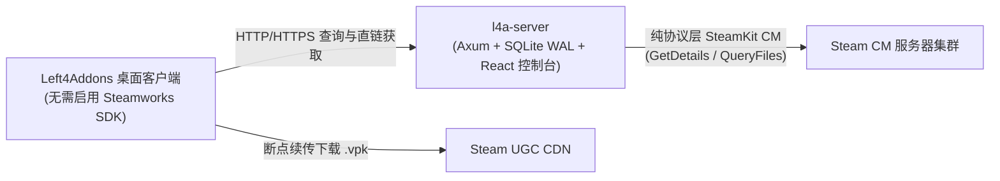

# Catalog Server (`l4a-server`) 介绍与部署指南

`l4a-server` 是 Left4Addons v2 中可独立自托管的 **SteamKit CM 创意工坊缓存下发服务**。它在服务端使用纯 Rust 实现的 Steam 客户端协议 (`steam-vent`) 直接拉取并缓存《求生之路 2》模组元数据、前置依赖、合集成员、画廊预览图与 `.vpk` 下载直链 (`file_url`)，让桌面客户端无需挂载受 VAC 限制的 Steamworks SDK 即可获得完整工坊能力。

---

## 一、核心架构与优势



1. **彻底规避客户端 VAC 冲突**：客户端只需将 `Catalog Server` 置于数据源首位，即可关闭本地 Steamworks SDK，直接从 Catalog 获取依赖拓扑与下载直链。
2. **无需环境变量与 API Key**：默认通过匿名 Steam CM 会话即可拉取 `file_url`；首次运行自动生成 `catalog.toml` 与随机强管理员密码。
3. **`file_url` 自动保鲜与首页隔离**：增量轮询与全量回填维护公开工坊目录，后台按 ID 分批复核已收录条目，按 ID 查询或下载时按 `item_ttl_secs` 触发穿透重刷；仅由客户端按 ID 穿透拉取的条目只保留在缓存中，不会污染公开工坊首页，且已收录目录条目不会在 TTL 到期后从首页消失。控制台可检索完整缓存。
4. **下架墓碑保护**：上游模组下架时保留已归档的历史元数据并清除下载直链。私密或不可用条目的公开缓存仅保留墓碑信息。

---

## 二、`catalog.toml` 配置文件详解

`l4a-server` 通过 `--config <PATH>`（默认 `./catalog.toml`）加载配置。文件不存在或缺少 `[admin].password` 时，服务会生成、保存并在启动日志中打印初始管理员密码。Unix 上新写入的配置与 Steam Guard 数据使用 `0600` 权限。

完整配置模板参见 [`crates/l4a-server/catalog.example.toml`](../../crates/l4a-server/catalog.example.toml)：

```toml
[server]
bind = "127.0.0.1:8787"
db_path = "./l4a-catalog.db"

[admin]
username = "admin"
password = "cat_auto_generated_strong_password"
session_ttl_hours = 168
allow_insecure_http = false # 仅本地 HTTP 开发时设为 true

[steam]
app_id = 550
mode = "anonymous" # 或在 Web 控制台中扫码登录自动切换为 "account"
guard_data_path = "./steam-guard.json"
request_concurrency = 4

[sync]
enable_read_through = true
item_ttl_secs = 900
enable_incremental_sync = true
incremental_interval_secs = 180
incremental_pages_per_tick = 2
enable_backfill = false
backfill_interval_secs = 15
backfill_batch_size = 50
```

---

## 三、构建与部署方案

### 方案 A：源码编译与 Systemd 部署

```bash
# 1. 构建 Catalog React 控制台静态产物并编译 Release 二进制
npm ci
npm run catalog:build
cargo build --release -p l4a-server

# 2. 安装二进制与数据目录
sudo cp target/release/l4a-server /usr/local/bin/l4a-server
sudo useradd --system --no-create-home --shell /usr/sbin/nologin l4a
sudo mkdir -p /var/lib/l4a-server
sudo chown -R l4a:l4a /var/lib/l4a-server
```

创建 `/etc/systemd/system/l4a-server.service`：

```ini
[Unit]
Description=Left4Addons SteamKit Catalog Server
After=network-online.target
Wants=network-online.target

[Service]
Type=simple
User=l4a
Group=l4a
WorkingDirectory=/var/lib/l4a-server
ExecStart=/usr/local/bin/l4a-server --config /var/lib/l4a-server/catalog.toml
Restart=always
RestartSec=5s
ProtectSystem=strict
ProtectHome=true
ReadWritePaths=/var/lib/l4a-server
NoNewPrivileges=true

[Install]
WantedBy=multi-user.target
```

启动后通过 `sudo journalctl -u l4a-server -n 30` 查看首次自动生成的管理员密码（或查看 `/var/lib/l4a-server/catalog.toml`）。

### 方案 B：Caddy / Nginx HTTPS 反向代理

在公网环境中建议使用 Caddy 或 Nginx 提供 HTTPS（桌面客户端默认启用“仅允许安全的 HTTPS 连接”）：

```caddy
catalog.example.com {
    encode gzip zstd
    reverse_proxy 127.0.0.1:8787
}
```

---

## 四、Web 管理控制台 (`GET /admin/`)

通过 HTTPS 反向代理访问 `/admin/` 时，管理员会话 Cookie 默认带 `Secure`。本地通过 `http://127.0.0.1:8787/admin/` 开发时，可在 `[admin]` 中显式设置 `allow_insecure_http = true`，使浏览器在 HTTP 上保留会话。

登录控制台后可执行：

1. **总览与同步引擎**：查看缓存命中/下架统计、按 Workshop ID 或链接手动预热抓取、立即触发增量同步、开启或重置全量工坊游标回填、在线调整 TTL 与轮询间隔（自动写回 `catalog.toml`）。
2. **SteamKit 账号会话**：支持通过 **Steam 手机令牌扫码**、**账号密码 + Steam Guard** 或 **Refresh Token** 登录普通 Steam 账号，登录态自动持久化为 `refresh_token`，也可随时一键切回匿名会话。
3. **工坊缓存库与人工覆写**：按关键词/标签/状态检索缓存、查看画廊与历史版本时间线、强制从 Steam CM 重刷单条直链，或对已下架模组配置人工覆写与锁定保护。
4. **安全与审计**：在线修改控制台管理员密码、审阅下架墓碑与人工操作审计记录。

---

## 五、在桌面客户端中接入

1. 打开 Left4Addons 桌面端 **设置 -> 数据源与 SDK**；
2. 在 **Catalog Server 地址** 填入服务地址（如 `https://catalog.example.com`）；
3. 将 `Catalog Server` 排在 **数据源优先级** 第一位，并可按需开启 **禁用 Steamworks SDK**。
